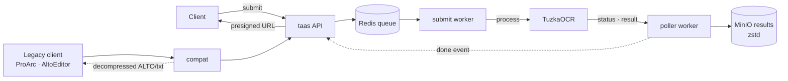

# tuzka-as-a-service (taas)

**Tuzka as a Service** — an async OCR gateway in front of the
[TuzkaOCR](https://github.com/moravianlibrary/TuzkaOCR) engine. It provides a
REST + WebSocket API, a job queue with multi-backend dispatch, result storage,
and a legacy-PERO compatibility layer for existing clients (ProArc, AltoEditor).



The Python package / CLI is named `taas`.

## Documentation

- [`app/`](app/README.md) — core server: API, workers, job lifecycle
- [`clients/`](clients/README.md) — Python & Java client libraries
- [`compat/`](compat/README.md) — legacy PERO-compatibility server
- [`deploy/helm/taas/`](deploy/helm/taas/README.md) — Helm chart ([architecture](deploy/helm/taas/ARCHITECTURE.md))
- [`bench/api/`](bench/api/README.md) — legacy-vs-new API benchmark ([results](bench/api/RESULTS_API.md))
- [`bench/`](bench/BENCHMARKS.md) — engine benchmarks: throughput, threading, memory

## Components

| Service | Role |
|---|---|
| `api` | REST + WebSocket API (jobs); its image also carries the `taas-admin` CLI — published on `:8080` |
| `worker-submit` | pulls queued jobs, dispatches to a healthy OCR backend |
| `worker-poller` | polls engine job status, harvests + stores results |
| `worker-cleanup` | TTL cleanup of buckets and old DB rows |
| `compat` | legacy PERO-style API → taas — published on `:8001` |
| `ocr-engine` | the TuzkaOCR engine (built from `./TuzkaOCR`) |
| postgres / redis / minio-incoming / minio-results | infrastructure |

## Prerequisites

- Docker + Docker Compose
- The TuzkaOCR engine source at `./TuzkaOCR` (it's **not** vendored in this repo):

  ```bash
  git clone https://github.com/moravianlibrary/TuzkaOCR.git TuzkaOCR
  ```

## Quickstart

```bash
make env             # create .env, .env.app and .env.local from templates (generates a Fernet key)
make up              # build + start the whole stack (first run is slow: TuzkaOCR model load)
make e2e-fast        # end-to-end: submit an image -> OCR -> fetch + preview the ALTO result
```

Administration: `make admin ARGS="--help"` (users, backends, config).
Job history and dashboards: ClickStack/HyperDX (`make up-clickstack`).

### Interactive API docs

Both services serve auto-generated OpenAPI docs (Swagger UI, ReDoc, raw schema):

| Service | Swagger UI | ReDoc | OpenAPI JSON |
|---|---|---|---|
| taas API | <http://localhost:8080/docs> | <http://localhost:8080/redoc> | <http://localhost:8080/openapi.json> |
| compat | <http://localhost:8001/docs> | <http://localhost:8001/redoc> | <http://localhost:8001/openapi.json> |

> The generated `KEY_ENCRYPTION_SECRET` is for local development. **Use your own for any
> real deployment.**

## Configuration

Each runnable piece reads its own env file; copy the matching `*.example`:

| File | Used by | Notes |
|---|---|---|
| `.env` | `docker compose` interpolation + postgres/minio/ocr containers | infra creds only |
| `.env.app` | `api` + workers (via `env_file:`) | every `app/config.Settings` field, in-cluster hostnames |
| `.env.local` | local `uvicorn` dev | same keys, `localhost` hostnames |
| `compat/.env.compat` | local compat dev | compat-only settings |

Live env files are git-ignored; only the `*.example` templates are tracked.

## Testing

```bash
make test                       # unit/component tests (pytest); the DB/Redis ones skip
make test-integration           # all of them, against a throwaway Postgres + Redis (test-env)
make coverage-report            # unit tests + coverage summary
make test-contract              # Schemathesis contract tests vs a running instance (needs the stack)
make e2e                        # full-stack end-to-end (brings the stack up), default fmt=multi
FMT=alto make e2e               # single-format run
make e2e-fast                   # against an already-running stack (no rebuild)
make e2e-batch                  # a batch: archive in, results archive out
make e2e-compat                 # legacy-compat server end-to-end
make check-alto-schema          # ALTO output vs the ALTO 4.4 XSD (needs ./TuzkaOCR, or FILES=)
```

`scripts/test.sh` saves each decompressed result under `test-data/out/` and
prints a preview — the ALTO XML and the OCR text extracted from it. Controls:
`IMAGE=`, `FMT=` (`alto`|`txt`|`multi`), `SHOW_RESULT=0`, `PREVIEW_LINES=`.

`make check-alto-schema` then validates that output — everything under
`test-data/out/*.alto.xml`, plus synthetic pages run through the engine's
`build_alto()` when the `./TuzkaOCR` clone is present. Validate specific files with
`make check-alto-schema FILES='path/to/*.xml'`. The schema is vendored offline under
`schemas/alto/`.

> `fmt=multi` (alto **and** txt from one request) requires engine-side support;
> until then use `FMT=alto` / `FMT=txt`.

## Benchmarks

Two independent sets of numbers, kept apart on purpose:

- **Engine** — how fast a page is OCR'd (threading, memory, pod shapes).
  See [`bench/BENCHMARKS.md`](bench/BENCHMARKS.md) and
  [`bench/PERF_REPORT.md`](bench/PERF_REPORT.md).
- **API** — how much throughput the *client protocol* costs: the legacy PERO API driven
  exactly as [ProArc](https://github.com/proarc/proarc) drives it (one page in flight,
  a fresh connection per page, 3 s polling) versus the taas client (everything submitted
  up front, results pushed over one WebSocket).

```bash
make bench                        # every enabled matrix, docker-compose stack
make bench ONLY=protocol N=25     # one matrix, 25 pages per case
make bench TARGET=k3d             # against the k3d/k3s deploy
make bench DRY_RUN=1              # print the plan + its estimated cost, run nothing
make bench-up                     # cold-start k3d first, then bench
```

What runs is defined by [`bench/api/scenarios.toml`](bench/api/scenarios.toml) (cartesian
sweeps; `enabled = false` marks a long block opt-in). Output is
[`bench/api/RESULTS_API.md`](bench/api/RESULTS_API.md) plus per-case JSON in
`bench/api/out/`. `make bench DRY_RUN=1` is worth running first — the default sweep is
~2.5 h on a GPU engine, and it prints the estimate before running anything.

The corpus is **not** in the repo, only the PID list: download the 200 pages in
`bench/api/mzk.pids.txt` (~118 MB) from Kramerius into `test-data/` as
`<uuid>_image.jpeg`. The list is size-stratified so the spread is preserved. Method,
the latency-proxy setup, and which column to read for which question are in
[`bench/api/README.md`](bench/api/README.md).

## Local development (without containers)

```bash
make infra          # postgres + redis + minio in Docker (also writes .env.local)
make db-upgrade     # migrate the infra DB
make dev-api        # the API with auto-reload on :8080 (DEV_PORT= to move it)
make dev-submit     # and/or dev-poller, dev-cleanup: one worker per terminal
```

All of them run in the locked uv env with `.env.local`'s settings (localhost hostnames).

## Deployment (Kubernetes / Helm)

A Helm chart lives in [`deploy/helm/taas/`](deploy/helm/taas/) (full stack: API, workers,
compat, Redis, PostgreSQL via CloudNativePG, MinIO, optional TuzkaOCR engine). Requires the
[CloudNativePG operator](https://cloudnative-pg.io/).

```bash
helm install taas ./deploy/helm/taas \
  --set secrets.keyEncryptionSecret=$(python -c "from cryptography.fernet import Fernet; print(Fernet.generate_key().decode())") \
  --set secrets.postgresPassword=$(openssl rand -hex 16) \
  --set secrets.minioIncomingSecretKey=$(openssl rand -hex 16) \
  --set secrets.minioResultsSecretKey=$(openssl rand -hex 16)
```

See the chart's [README](deploy/helm/taas/README.md) (install, exposure, values) and
[ARCHITECTURE](deploy/helm/taas/ARCHITECTURE.md) (topology, hooks, request flow).

## Make targets

Run `make help` for the full list, grouped as compose stack (`up`, `down`, `logs-<svc>`,
`clean-volumes`, …), host dev (`dev-api`, `dev-<worker>`), database (`db-*`), tests
(`test`, `test-integration`, `e2e-*`), local k3d, bench, quality (`check`) and release.
