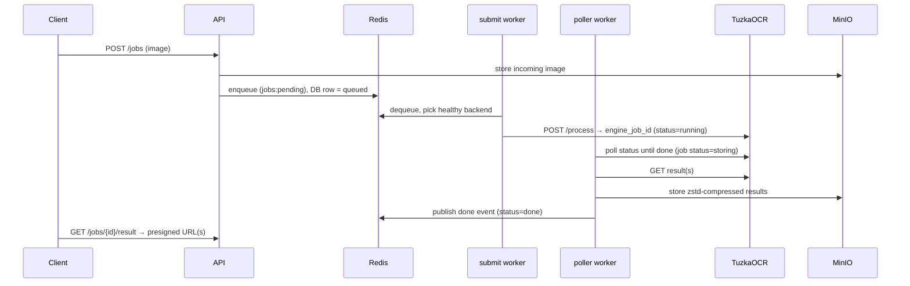

# `app/` — taas core server

The FastAPI application and background workers that make up **Tuzka as a Service**:
the public API, the job queue lifecycle, result storage, and the `taas-admin` CLI.
For the project overview and quickstart, see the [root README](../README.md).

## Layout

| Path | Responsibility |
|---|---|
| `main.py` | app factory (`create_app`), router wiring, `/healthz`; `/` redirects to `/docs` |
| `config.py` | `Settings` (pydantic-settings) — read from `.env.local` / container env |
| `deps.py` | FastAPI dependencies: DB session, Redis, auth (`require_user` / `require_principal`, with the key's scope), rate limiters |
| `models/` | SQLAlchemy models — `user`, `job` (+ `JobResult`), `backend`, `storage_config`, `db` |
| `schemas/` | Pydantic request/response schemas of the public API |
| `core/` | admin operations (`admin_ops.py`) and their schemas, used by the CLI |
| `cli/` | `taas-admin`, the admin CLI (Typer) |
| `routers/` | HTTP/WebSocket endpoints — `jobs`, `ws` |
| `services/` | `auth`, `scopes`, `storage` (MinIO), `redis_jobs` (queue/state), `retention`, `events` |
| `workers/` | standalone processes — `submit`, `poller`, `cleanup` |

## Authentication

| Header | Used by | Identifies |
|---|---|---|
| `X-API-Key` | `/api/v1/*`, `/ws` | a user (hashed key looked up in `users`) |

## API

Interactive OpenAPI docs are served at <http://localhost:8080/docs> (Swagger UI),
<http://localhost:8080/redoc> (ReDoc), and <http://localhost:8080/openapi.json> (raw schema).

### Jobs — `/api/v1` (user key, rate-limited)

| Method | Path | Notes |
|---|---|---|
| `POST` | `/jobs` | multipart: `image` (required), `external_id?` (your own label: any string ≤ 255 chars, not unique), `domain?`, `outputs?` (or `fmt`), `options?` → `202 {job_id, external_id, status}` |
| `GET` | `/jobs/{job_id}` | job status |
| `GET` | `/jobs/{job_id}/result` | `{results:[{fmt, url}]}` — presigned URLs (public endpoint, regenerated if expired) |
| `GET` | `/jobs/{job_id}/result/{fmt}/download` | stream the stored artifact through taas (internal endpoint; for callers that can't reach the public presign host, e.g. compat) |
| `GET` | `/jobs?status=&limit=&offset=` | paginated list (scoped to the user) |

A key can be **scoped** to some domains and/or outputs (`taas-admin user set-scopes`);
an out-of-scope submit is a `403`.

## Administration — `taas-admin`

There is no HTTP admin API: operators use the `taas-admin` CLI, which ships in the api
image and writes to Postgres directly.

```bash
docker compose exec -T api taas-admin --help                       # compose
kubectl -n taas exec deploy/taas-api -- taas-admin --help          # Kubernetes
```

| Group | Commands |
|---|---|
| `user` | `list`, `create` (prints the key once), `delete`, `rotate-key`, `set-key --key-env VAR`, `enable`, `disable`, `set-priority`, `set-limits`, `set-scopes` |
| `backend` | `list`, `upsert --url … [--api-key-env VAR]` (idempotent), `update`, `enable`, `disable`, `delete` |
| `domain` | `list`, `set-label`, `set-legacy-id` |
| `config` | `list`, `get`, `set` (JSON values) |
| `job` | `list-failed`, `show <id>` (with every failed attempt) |

Tables by default, `--json` for scripts. Secrets are read from a named env var, never
from argv. API processes cache key lookups for 10 s, so key and scope changes apply
within that; the submit worker reloads backends every 30 s
(`BACKEND_REFRESH_SECONDS`), so a backend change takes up to that long. Scripts use `scripts/lib/taas-admin.sh` (`TAAS_ADMIN_MODE=compose|k3d`).
Job history and dashboards are in ClickStack (HyperDX), not in taas.

### WebSocket — `/ws?api_key=...`

On connect: replays `done`/`failed` jobs finished within `WS_CATCH_UP_SECONDS`, then streams
live events. Event JSON:

```json
{"job_id": "...", "external_id": "<your label or null>", "status": "done", "alto_url": "...", "txt_url": "..."}
{"job_id": "...", "external_id": null, "status": "failed", "error": "..."}
{"type": "batch", "batch_id": "...", "total": 120, "done": 80, "failed": 2}
```

Match events on `job_id` (submit returned it). A page of a batch also carries
`batch_id`; its results come with the batch archive.

### Batches — `/api/v1/batches` (user key)

| Method | Path | Notes |
|---|---|---|
| `POST` | `/batches` | multipart: `archive` (`.tar`, `.tar.gz`, `.tar.zst` or `.zip`; ≤ `BATCH_MAX_UPLOAD_BYTES`, 2 GiB), `external_id?`, `domain?`, `outputs?`, `options?` → `202 {batch_id, external_id, total, skipped}`. Each image (≤ `BATCH_MAX_PAGES`, 2000) is a job; other files are skipped. One submit from the rate limit. |
| `GET` | `/batches/{id}?pages=1` | counts (`queued`, `running`, `done`, `failed`), `eta_s`, and with `pages=1` every page's `source_name`, `job_id`, `status`, `error` |
| `GET` | `/batches/{id}/results?partial=1` | `202` until finished; then `{url, expires_at}` of a `.tar.zst` with `pages/…` and `manifest.json` (built once). `partial=1`: an archive of what's done so far |
| `POST` | `/batches/{id}/retry` | resubmits a finished batch's failed pages |

A batch's pages run in archive order and are identified by `source_name` (their path in
the archive). A finished batch goes after the done TTL, or the failed TTL if a page
failed, with its pages and archive.

## Dispatch

The submit worker takes jobs in queue order (user priority first) and, within the
highest **backend priority** tier that can serve each one, sends it to the backend that
would **finish it first**: its pages in flight, at its **measured speed** (engine seconds
per megapixel for the domain, an average of recent pages), for the page's size, over its
`max_inflight` slots. A backend with under 5 measured pages borrows the others' median.
Failed attempts that are the backend's fault (transport errors, 5xx) make it look up to
10× slower, fading again as its pages succeed, so a flaky backend gets less work on its
own. A page of a batch prefers a backend already running that batch when it's within
`dispatch.affinity_tolerance` (config, default 0.15) of the fastest. A retry still
avoids the backend that failed it first.

## Job lifecycle



Statuses: `queued → running → done` (or `failed`).

## Workers

Each runs as its own process (one container per worker in compose):

```bash
python -m app.workers.submit    # dequeue → dispatch to a healthy backend
python -m app.workers.poller    # poll engine status → harvest + store results → publish events
python -m app.workers.cleanup   # reaper (every ~60s) + TTL cleanup of buckets and old DB rows (~10 min)
```

The cleanup worker also runs a **reaper** every ~60s: jobs stuck in `queued` past
`jobs.queued_timeout_seconds` (default 900) or `running` past
`jobs.running_timeout_seconds` (default 300) are marked `failed`, their backend slot
released, and a WS `failed` event emitted. These timeouts and the presigned-URL window
(`presigned.ttl_minutes`, default 60) live in the DB `config` table (set with
`taas-admin config set`). The Redis job-state TTL is computed as
`queued + running + 60s`.

**Retention** (`app/services/retention.py`, every cleanup tick). Postgres keeps live
state; history is in ClickHouse.

| Config key | Default | What goes |
|---|---|---|
| `jobs.done_ttl_seconds` | 86400 (1 day) | `done` job rows (and their results) this long after they finished |
| `jobs.failed_ttl_seconds` | 604800 (7 days) | `failed` job rows, kept longer for debugging |
| `storage.results_max_age_seconds` | 86400 | result objects this old (downloadable until then, any number of times) |
| `storage.results_max_bytes` | unset (no cap) | when results stored exceed it, the oldest go first, down to 90 % |

An evicted result's endpoints answer **410 Gone** until its job row expires.

## Tracing

OpenTelemetry traces and logs, **off by default**. Set `OTEL_EXPORTER_OTLP_ENDPOINT` on
the api and the workers to export over OTLP/HTTP (e.g. to ClickStack's collector);
without it nothing is set up and nothing is paid. The rest is the standard SDK env:

| Variable | Default | Notes |
|---|---|---|
| `OTEL_EXPORTER_OTLP_ENDPOINT` | unset (off) | collector base URL, e.g. `http://otel-collector:4318` |
| `OTEL_SERVICE_NAME` | `taas-api`, `taas-submit`, `taas-poller`, `taas-cleanup` | per process |
| `OTEL_EXPORTER_OTLP_HEADERS` | — | e.g. an ingestion key, `authorization=…` |
| `OTEL_RESOURCE_ATTRIBUTES` | — | e.g. `deployment.environment=prod` |

Each job is **one trace**: the submit request stores the W3C `traceparent` in the job's
Redis hash, and the dispatcher's `dispatch` span and the poller's `poll`, `harvest` and
`fail` spans continue it, with the engine HTTP calls, SQL and Redis commands inside.
Every other API request is a trace of its own, except `/healthz` and `/load`.

That's all that's traced. The workers' loops run a Redis command or a SQL query per
backend every second, plus health checks; traced, that would be ~0.7M + 0.18M × engines
one-span traces a day. So the workers record spans only inside a job's trace (a
parent-based sampler with root spans off), and drop the rest when they're created.
Python log records are exported from every process either way, carrying the trace id
when there is one. See `app/telemetry.py`.

The chart's OTel collector does the sampling, not the app: it keeps every trace with
an error span or a job's `fail` span, and samples the rest at
`clickstack.otel.traceSamplePercentage` (default 5%). It also drops log records below
WARN, so INFO stays on stdout but does not grow `otel_logs`. Because a job trace can
span minutes, `clickstack.otel.traceDecisionWait` (default 10m) must exceed the
longest job; the collector holds traces in memory until then.

## Running

Containers (with the rest of the stack): see the [root README](../README.md) (`make up`).

Locally:

```bash
make infra                     # postgres + redis + minio in Docker
pip install -e "..[api]"       # taas + web/api deps (workers need only `..`)
alembic upgrade head           # apply migrations (config in ../alembic)
cp ../.env.local.example ../.env.local
uvicorn app.main:app --reload --port 8080
# workers, in separate shells:
python -m app.workers.submit & python -m app.workers.poller & python -m app.workers.cleanup
```

Configuration keys are documented in `../.env.app.example`.
